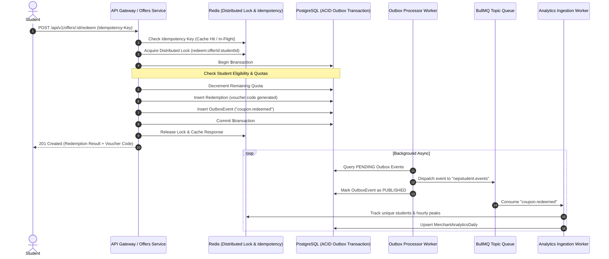

# 🇳🇵 NepStudent — Event-Driven Microservices Architecture

## Executive Overview
NepStudent is an event-driven student discount marketplace and verification platform designed for Nepal (Kathmandu, Lalitpur, Bhaktapur).

The architecture is built upon:
1. **Asynchronous Event-Driven Architecture (EDA)** with Redis + BullMQ.
2. **Transactional Outbox Pattern** to prevent dual-write loss and guarantee at-least-once message delivery.
3. **Microservices Domain Boundaries**:
   - **Identity & Verification Service**: Student onboarding, institutional roster verification, document uploads, admin review queue.
   - **Offers & Redemption Service**: Discount catalog, atomic quota protection, single-student limits, cryptographic voucher issuance.
   - **Analytics & Business Insights Service**: High-speed real-time event aggregation, vendor conversion rates, university demographic metrics.
4. **Resilient API Standards**:
   - Strict Zod DTO validation.
   - Distributed Idempotency middleware (`Idempotency-Key` header with 24-hour replay caching).
   - Distributed Locks (`Redlock` pattern with Lua release scripts) preventing race conditions on coupon redemption.
   - Correlation IDs (`x-correlation-id`) across API requests and BullMQ event envelopes.
   - RFC 7807 Problem Details error schemas.

---

## 🏛️ Event-Driven Domain Flow



---

## 📡 Registered Domain Events

| Event Name | Aggregate | Trigger | Consumer |
|---|---|---|---|
| `student.verified` | `StudentProfile` | Instant roster match or Admin approval | Analytics Worker, Eligibility cache, Notification Service |
| `coupon.redeemed` | `Offer` | Student claims coupon code | Analytics Worker (daily & live aggregates), Merchant Dashboard |
| `redemption.failed` | `Offer` | Quota depleted, expired, or ineligible | Risk & Fraud telemetry |

---

## 🛠️ Microservices Execution Modes

### 1. Monolith Dev Mode (Single Process)
Runs HTTP API, Outbox poller, and BullMQ worker together in dev:
```powershell
npm run dev
```

### 2. Standalone Microservice Mode (Distributed)
In production or containerized environments, workers can scale horizontally without touching HTTP traffic:
```powershell
# Run API Web Nodes:
npm run start

# Run Distributed Event Worker Nodes:
npm run worker:start
```
